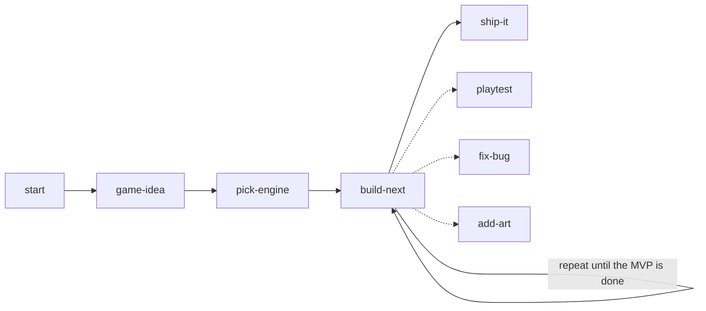

<div align="center">

# downbelow-skills

### Make your first game with AI, one playable step at a time.

No coding experience needed. Bring an idea, or don't.<br>
Works with **Claude Code**, **Codex**, **Cursor**, and any agent that reads `SKILL.md` files.

<a href="LICENSE"></a>
<a href="skills"></a>


[Quick start](#quick-start) · [How it works](#how-it-works) · [What to say](PROMPTS.md) · [All skills](#the-skills) · [FAQ](#faq)

</div>

---

AI coding tools can build a game, but left alone they often build too much, say it works without ever running it, and lose track between chats. These skills give the AI a beginner-friendly way of working:

- **Keep it small.** A one-page plan with at most 5 must-haves, so you actually finish.
- **Playable every step.** Each step ends with something new you can try, never just "planning".
- **Run it and look.** The AI plays the game before saying "done", then hands it to you.
- **Never lose work.** Every working step is saved as a checkpoint you can go back to.
- **Remembers where you left off.** One progress file carries the project between sessions.

No studio of 49 agents, no 30 design docs. **8 skills, 2 files, nothing extra to install.**

## Quick start

**1. Make an empty folder for your game and open it in your AI tool.**

**2. Paste this:**

```text
Pull the skills from https://github.com/downbelowdotxyz/downbelow-skills into this project, set up the way you load skills, and add its AGENTS.md rules. Then use the start skill.
```

That's it. The AI sets itself up, checks your computer has what it needs, and asks what you want to make.

> **You'll need:** an AI coding tool, [Git](https://git-scm.com/downloads), and [Node.js](https://nodejs.org/) 20+ for browser games. Not sure if you have them? The `start` skill checks for you.

## What it looks like

```text
You:   Use the start skill. I want to make a game.

AI:    Where are you starting from?  No idea yet / Rough idea / Clear idea / Already started

You:   Rough idea, something with a frog.

AI:    Three small ones to pick from:
         1. Hop across a pond of sinking lily pads before they go under.
         2. Catch flies with your tongue; every miss makes the frog sleepier.
         3. A frog delivers mail across a busy road (one level, five letters).

You:   1, but at night with fireflies.

AI:    Here's your one-page brief. MVP: frog hops, pads sink, fireflies give points,
       fall in = game over, score on screen. Save it as game-brief.md?
       ...
AI:    Done: arrow keys move the frog, and I played it to check. Open
       http://localhost:5173 and try it. Saved a checkpoint. Does the hop feel too slow?
```

## How it works



| | Skill | You end up with |
|:-:|---|---|
| **0** | [**start**](skills/start/SKILL.md) | The AI knows where you are, and your computer is ready. |
| **1** | [**game-idea**](skills/game-idea/SKILL.md) | `game-brief.md`: a one-page plan with 5 must-haves or fewer. |
| **2** | [**pick-engine**](skills/pick-engine/SKILL.md) | A project that runs, with something you control moving on screen. |
| **3** | [**build-next**](skills/build-next/SKILL.md) | One new playable piece, tested and saved. **Repeat until the list is done.** |
| ⟲ | [**playtest**](skills/playtest/SKILL.md) | Proof a change works: the AI plays it, then you do. |
| ⟲ | [**fix-bug**](skills/fix-bug/SKILL.md) | One problem found and fixed without breaking the rest. |
| ⟲ | [**add-art**](skills/add-art/SKILL.md) | Real art and sound (free pack, drawn yourself, or AI), imported right and credited. |
| **4** | [**ship-it**](skills/ship-it/SKILL.md) | A link on itch.io or GitHub Pages your friends can play. |

**Two files keep it on track:**

| File | What it holds |
|---|---|
| `game-brief.md` | **What** you're making. The AI won't add things that aren't on it without asking. |
| `PROGRESS.md` | **Where you left off.** The AI reads it first every session, so you can stop anytime. |

**Default tech:** a browser game with [Phaser](https://phaser.io) (2D) or [Three.js](https://threejs.org) (3D) on [Vite](https://vite.dev). It runs with one command, the AI can open and test it itself, and you can share it with a link. Want Godot, Unity, or Unreal instead? Just say so.

## Tips that save beginners hours

| Tip | Why |
|---|---|
| **Play every step** | When the AI says "done", try it. "The jump feels floaty" is the most useful thing you can tell it. |
| **Small game first** | Your dream RPG is a great *second* game. A finished small game teaches you more than half of a big one. |
| **Squares are fine** | Real games start with placeholder shapes. Make it fun first, pretty later. |
| **New day, new chat** | Start a fresh conversation each session. `PROGRESS.md` remembers for you. |
| **Broke it? Go back** | Say "go back to the last checkpoint" and the last step is undone. |
| **Paste the error** | Copy the red text from the browser console (right-click → Inspect → Console) and paste it in. |

More things to say: **[PROMPTS.md](PROMPTS.md)**

## The skills

The 8 beginner skills above, plus specialists the AI uses when your game needs them (or ask for one by name):

| Skill | Use it for |
|---|---|
| [game-foundation](skills/game-foundation/SKILL.md) | Title screen, menus, pause, settings, game over, restart: the "shell" around your game. |
| [game-ui-screens](skills/game-ui-screens/SKILL.md) | Menus and HUD that look like a game, not a website. |
| [mobile-game-controls](skills/mobile-game-controls/SKILL.md) | Touch controls, virtual joystick, portrait vs landscape. |
| [open-source-game-worlds](skills/open-source-game-worlds/SKILL.md) | Finding free art and models, and checking you're allowed to use them. |
| [game-3d-assets](skills/game-3d-assets/SKILL.md) | Making or fixing real 3D models. |
| [game-asset-pipeline](skills/game-asset-pipeline/SKILL.md) | Importing asset packs reproducibly, with credits. |
| [game-world-layout](skills/game-world-layout/SKILL.md) | Maps, zones, spawn points, level layout. |
| [game-physics-regression](skills/game-physics-regression/SKILL.md) | Movement and collision bugs that won't go away. |
| [game-performance-engineering](skills/game-performance-engineering/SKILL.md) | "My game got slow." |
| [webgl-frame-profiling](skills/webgl-frame-profiling/SKILL.md) | Deep FPS investigation for browser 3D games. |
| [colyseus-vite-multiplayer](skills/colyseus-vite-multiplayer/SKILL.md) | Real online multiplayer with friends. A big step: make the single-player version first. |

Each skill is a self-contained folder. Only want a couple? Ask for them by name: *"pull the playtest and fix-bug skills from …"*.

## Tools and MCPs

**Nothing extra is required.** The skills use the command-line tools already on your computer (`git`, `node`/`npx`, and `godot` or `blender` if you have them) plus whatever your AI tool can already do. If your AI can't open a browser, it runs one with `npx playwright` or asks you to play and paste a screenshot.

MCP servers are optional power-ups. The skills use them if you've connected one, and never ask you to set one up first:

| Power-up | What it adds | Heads-up |
|---|---|---|
| [Playwright MCP](https://github.com/microsoft/playwright-mcp) | Lets the AI drive a real browser to play and screenshot your game. | Skip it if your AI tool already has a browser. |
| [Blender MCP](https://github.com/ahujasid/blender-mcp) | Lets the AI model and edit 3D scenes live in Blender. | Community project. It runs code the AI writes on your computer, so only use it if you're comfortable with that. |
| Godot / Unity MCPs | Let the AI work inside the editor. | Several community versions exist; check how active and trusted one is before installing. |

## FAQ

<details>
<summary><b>Do I really not need to know how to code?</b></summary>

You don't need to write code. You do need to play what the AI builds and tell it what feels wrong. You'll pick up how things work along the way, because the AI explains each step in plain words.
</details>

<details>
<summary><b>How long does it take?</b></summary>

Something moving on screen comes in your first session. A small, complete first game (a start screen, a goal, a way to lose, and play again) usually takes a few sessions. Bigger ideas get trimmed to a small first version, and that's on purpose.
</details>

<details>
<summary><b>What kinds of games work best?</b></summary>

Small 2D arcade, puzzle, platformer, and top-down games are the sweet spot for a first game. Small 3D games work too. Online multiplayer, huge open worlds, and long stories are better as a second or third project.
</details>

<details>
<summary><b>Where do art and sounds come from?</b></summary>

Usually a free pack first ([Kenney](https://kenney.nl/assets) is CC0, so you can use it in anything). If you want to make your own: Piskel or Aseprite for pixel art, Blockbench for low-poly 3D, Blender for everything else, jsfxr for sound effects, and BeepBox for music. AI generators work for props and placeholders. The `add-art` skill picks the right one, checks the license, and imports it correctly.
</details>

<details>
<summary><b>Does it cost anything?</b></summary>

These skills are free (MIT). You need access to an AI coding tool, which may have its own plan. Phaser, Three.js, Vite, Godot, and itch.io are free.
</details>

<details>
<summary><b>I already started a game. Can I still use this?</b></summary>

Yes. Pull the skills into your existing project and use `start`. It reads what's there, writes a `PROGRESS.md`, and continues from where you are without rewriting your project.
</details>

<details>
<summary><b>For AI agents: how to pull these skills into a project</b></summary>

1. Copy each folder in `skills/` **whole** (its `SKILL.md`, `references/`, `scripts/`, `agents/`) to wherever you load skills for this project. Skills use the shared `SKILL.md` format, and the folder name is the skill name. Common places: `.claude/skills/` (Claude Code), `.agents/skills/` (Codex, Cursor), `.cursor/skills/` (Cursor). Pick one so skills don't show up twice.
2. Put the ground rules from [`AGENTS.md`](AGENTS.md) where you read project instructions (`AGENTS.md`, `CLAUDE.md`, `.cursor/rules/`, …). If that file already exists, add the rules as a section instead of replacing it.
3. If you can't load skills natively, keep the folders anywhere in the project and add a line to your instructions file: read the matching `SKILL.md` before doing that kind of task.
4. Don't copy `README.md`, `PROMPTS.md`, or `LICENSE` into the game. Tell the person which skills were added and where, then run `start`.
</details>

## License

[MIT](LICENSE) © downbelowdotxyz
